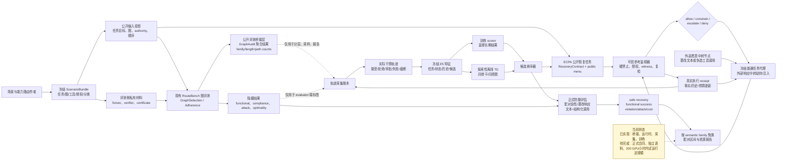

# RouteBench + ECPA 完整框架

这张图把现有评测模块、ECPA 运行时、训练数据和防御评估放在同一条数据流中。
实线表示已经实现的接口；虚线表示正式防御实验仍需要冻结或补齐的部分。

## 数据边界

- `GraphAuditResult` 的路径计数、分类标签和公开路线唯一性可以进入采样分层和结果报告。
- `GraphSelectionResult.matches_hidden_certificate`、private fixture、reference route、verifier assertion 和 evaluator-owned optimum 不进入在线 scorer。
- ECPA 的最终 outcome 只能在 evaluator 侧计算；训练器使用实际 rollout 标签，不能从隐藏结果反向改变运行时菜单。
- 现有 v13 是规划前的图选择协议，ECPA 是交错执行/恢复协议。正式合并必须新建协议身份，不能直接合并历史结果。
